<a href="https://avenoric.tech">
  <picture>
    <source media="(prefers-color-scheme: dark)" srcset="./assets/hero-dark.svg">
    
  </picture>
</a>

 

I'm the founder of **[Avenoric](https://avenoric.tech)**, a product-first AI company. I started building our first product, ExplainMate, at 14. Today it has **20,000 users**. We're bootstrapped, so every product decision has to pay for itself.

How I work: start from a real problem, ship the product, and build deeper AI systems only where they give a real advantage.

 

## Products

  <a href="https://explainmate.tech"><picture>
    <source media="(prefers-color-scheme: dark)" srcset="./assets/card-explainmate-dark.svg">
    
  </picture></a>
  <a href="https://plintrix.tech"><picture>
    <source media="(prefers-color-scheme: dark)" srcset="./assets/card-plintrix-dark.svg">
    
  </picture></a>

Product code is closed source. The builds below are open.

 

## Open source

<a href="https://github.com/kanaktronics/FixIT-SLM"><picture>
  <source media="(prefers-color-scheme: dark)" srcset="./assets/build-fixit-dark.svg">
  
</picture></a>

<a href="https://github.com/kanaktronics/fluxsentinel-ai"><picture>
  <source media="(prefers-color-scheme: dark)" srcset="./assets/build-flux-dark.svg">
  
</picture></a>

<a href="https://github.com/kanaktronics/stumpai"><picture>
  <source media="(prefers-color-scheme: dark)" srcset="./assets/build-stump-dark.svg">
  
</picture></a>

 

## Notes from production

<picture>
  <source media="(prefers-color-scheme: dark)" srcset="./assets/production-dark.svg">
  
</picture>

 

## The road so far

<picture>
  <source media="(prefers-color-scheme: dark)" srcset="./assets/journey-dark.svg">
  
</picture>

 

## Latest writing

<!-- WRITING:START -->
- **[The Product Is the Point: How We Decide What to Build](https://avenoric.tech/news/the-product-is-the-point)** COMPANY · Jul 2026
- **[Making AI Reliable Enough to Ship](https://avenoric.tech/news/making-ai-reliable-enough-to-ship)** ENGINEERING · Jul 2026
- **[Learning That Connects](https://avenoric.tech/news/learning-that-connects)** PRODUCT · Jul 2026
- **[Right-Sized AI for Right-Sized Problems](https://avenoric.tech/news/right-sized-ai-for-right-sized-problems)** ENGINEERING · Jun 2026
<!-- WRITING:END -->

Pulled daily from the <a href="https://avenoric.tech/news">Avenoric blog</a> by a GitHub Action in this repo.

 

## Stack

`TypeScript` `Next.js` `React` `Node.js` `Postgres / Supabase` `Python` `PyTorch` `Ollama` `Google Cloud` `Vercel`

 

<a href="https://avenoric.tech">avenoric.tech</a> · <a href="mailto:hello@avenoric.tech">hello@avenoric.tech</a> · <a href="https://www.instagram.com/kanak_.raj">Instagram</a> · <a href="https://www.youtube.com/@kanakrajdaily">YouTube</a> · <a href="https://www.linkedin.com/company/112764518">LinkedIn</a>

<picture>
  <source media="(prefers-color-scheme: dark)" srcset="./assets/footer-dark.svg">
  
</picture>
